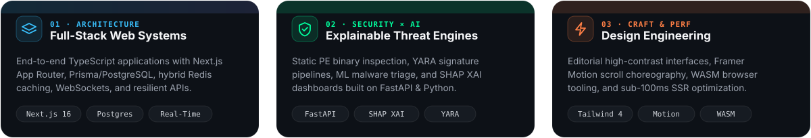
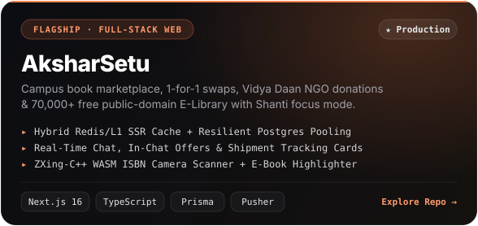
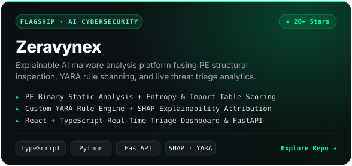

<!-- HERO BANNER -->

  

<!-- QUICK ACTIONS & LIVE METRICS -->

  
  
  
  
  

<!-- ENGINEERING PILLARS BENTO -->

 

## Selected Work

<table>
  <tr>
    <td width="50%" align="center">
      
    </td>
    <td width="50%" align="center">
      
    </td>
  </tr>
</table>

<strong>Explore More Shipped Repositories</strong> — commercial web apps, bots &amp; security utilities

 

| Repository | Domain | Stack | Highlights |
| :--- | :--- | :--- | :--- |
| [**SethiAluminium**](https://github.com/intrance7/SethiAluminium) | Commercial Web | `TypeScript` · `Next.js` · `Tailwind` | Production business showcase and catalog experience |
| [**mehta_boot_house**](https://github.com/intrance7/mehta_boot_house) | E-Commerce UI | `TypeScript` · `React` | Modern footwear storefront with responsive product grids |
| [**BrainrotBot**](https://github.com/intrance7/BrainrotBot) | Automation | `TypeScript` · `Node.js` | Event-driven bot architecture with clean modular commands |
| [**EcoPlus**](https://github.com/intrance7/EcoPlus) | Web Application | `JavaScript` · `Web` | Sustainability-focused interactive web platform |
| [**Keylogger**](https://github.com/intrance7/Keylogger) | Security Research | `Python` | Ethical self-monitoring utility with timestamped telemetry |

 

  

## Technical Stack

| Layer | Core Technologies | Production Capabilities |
| :--- | :--- | :--- |
| **Frontend & UI Systems** |  | `App Router & RSC` · `Framer Motion` · `Design Systems` · `WASM Tooling` · `Core Web Vitals` |
| **Backend & Data** |  | `REST & WebSockets` · `Hybrid Redis Caching` · `NextAuth / OAuth` · `Connection Pooling` |
| **AI & Security** |  | `YARA Rules` · `PE Static Parsing` · `SHAP (XAI)` · `Scikit-Learn` · `Ghidra` · `Wireshark` |
| **Infra & Workflow** |  | `CI/CD Pipelines` · `Edge Deployments` · `Telemetry & Profiling` · `Automated Workflows` |

 

  

## Engineering Telemetry

<picture>
  <source media="(prefers-color-scheme: dark)" srcset="https://raw.githubusercontent.com/intrance7/intrance7/output/github-contribution-grid-snake-dark.svg" />
  <source media="(prefers-color-scheme: light)" srcset="https://raw.githubusercontent.com/intrance7/intrance7/output/github-contribution-grid-snake.svg" />
  
</picture>

 

 

  
  &nbsp;
  

 

<!-- FOOTER SIGNATURE -->

